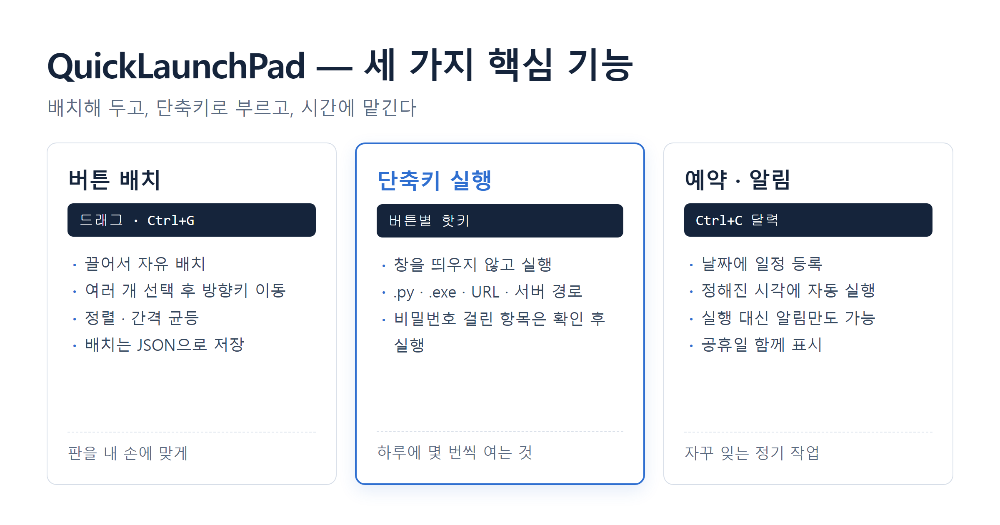
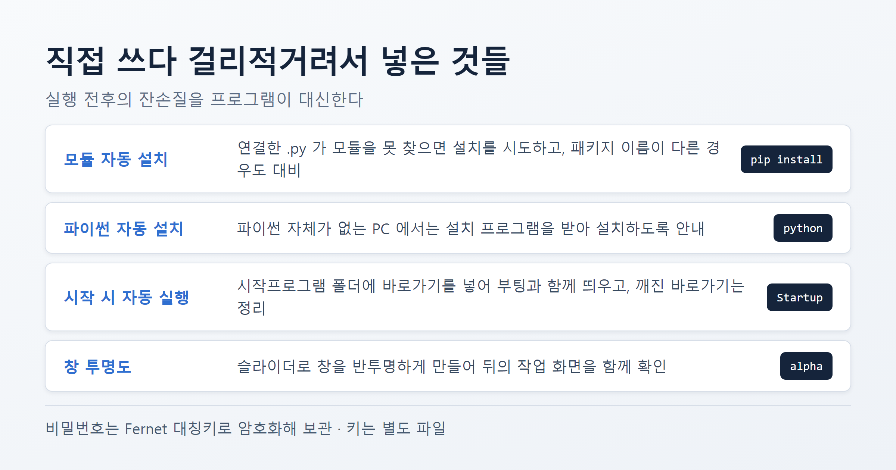

# QuickLaunchPad

바탕화면에 흩어진 바로가기를 **한 화면에 모아 버튼이나 단축키로 실행**하는 윈도우용 런처입니다.
파이썬 + tkinter 로 만들었습니다.



## 왜 만들었나

바탕화면 아이콘이 수십 개가 되면 **찾는 시간이 실행하는 시간보다 길어집니다.**
폴더로 묶으면 두 번 클릭해야 하고, 작업 표시줄은 고정할 수 있는 개수가 제한됩니다.

자주 쓰는 것만 **한 판에 모아 두고 키 하나로 띄우자**는 게 출발점이었습니다.

## 주요 기능

| 기능 | 설명 |
|---|---|
| 버튼 배치 | 파일·폴더·URL 을 드래그로 배치. 격자 정렬(`Ctrl+G`)·간격 균등 지원. 배치는 JSON 으로 저장 |
| 단축키 실행 | 버튼마다 핫키 지정. **창을 띄우지 않고 실행**. `.py` · `.exe` · URL · 서버 경로 모두 가능 |
| 예약 실행 | 지정 시각에 **실행** 또는 **알림** 중 선택 |
| 달력 | `Ctrl+C` 로 열림. 날짜에 일정 등록, 한국 공휴일 표시 |
| 창 투명도 | 슬라이더로 조절 |
| 시작프로그램 등록 | `%APPDATA%` 시작프로그램 폴더에 바로가기 생성 |
| 비밀번호 보호 | 버튼별 비밀번호. **Fernet(AES-CBC + HMAC)** 으로 암호화해 저장 |

## 스크립트를 버튼으로 걸어 두기

이 런처가 가장 쓸모 있는 순간은 **직접 만든 파이썬 스크립트를 걸어 둘 때**입니다.
매달 반복하는 작업을 `.py` 로 만들어 버튼에 걸면, 폴더를 열고 코드를 돌리던 과정이 **단축키 하나**로 끝납니다.



## 설치와 실행

**요구 사항** — Windows · Python 3.10 이상

```bash
git clone https://github.com/smileku1/QuickLaunchPad.git
cd QuickLaunchPad
python Quicklaunchpad.py
```

필요한 모듈이 없으면 실행 시 `pip install --user` 로 자동 설치를 시도합니다.

### 실행 파일로 만들기

```bash
pyinstaller QuickLaunchPad.spec
```

## 파일 구성

| 파일 | 역할 |
|---|---|
| `Quicklaunchpad.py` | 본체 (UI · 버튼 · 예약 · 달력) |
| `ql_utils.py` | 공용 유틸 |
| `QuickLaunchPad.spec` | PyInstaller 빌드 설정 |

## 보안에 관해

- 버튼 비밀번호는 **평문으로 저장하지 않습니다.** `cryptography` 의 Fernet 으로 암호화합니다.
- 암호화 키는 **실행 시 로컬에 생성**되며 저장소에 포함되지 않습니다 (`.gitignore`).
- 설정 파일(`*.json`)도 사용자 데이터이므로 커밋하지 않습니다.

## 만든 과정과 사용법

제작 배경, 처음 쓰는 순서, 만들면서 손봐야 했던 것들을 블로그에 정리했습니다.

- **[바탕화면 정리 프로그램 무료 — 아이콘 더미를 버튼 한 판으로](https://quicklaunchpadoriginal.tistory.com/14)**

버튼에 걸어 두면 좋은 파이썬 스크립트도 글로 남겨 두었습니다. 전부 직접 실행해 결과를 확인한 코드입니다.

- [엑셀 파일 여러 개 합치기 — pandas 로 폴더째 병합](https://quicklaunchpadoriginal.tistory.com/2)
- [파이썬 엑셀 저장·쓰기 — DataFrame 을 엑셀로 내보내기](https://quicklaunchpadoriginal.tistory.com/7)
- [PDF 용량 줄이기 — 설정별 실측 비교와 파이썬 자동화](https://quicklaunchpadoriginal.tistory.com/9)

## 라이선스

MIT — [LICENSE](LICENSE) 참고
